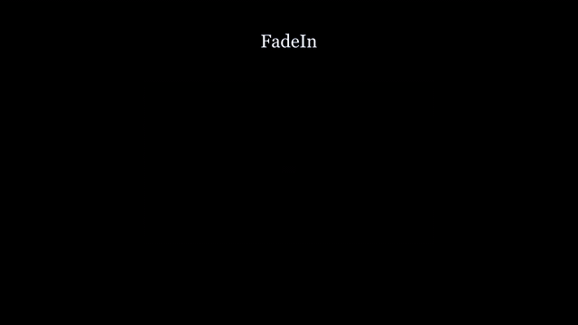
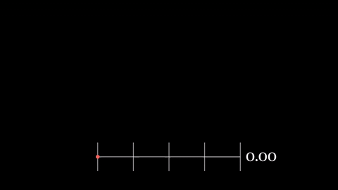
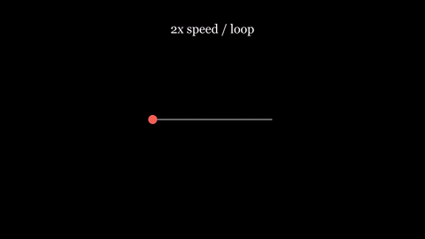
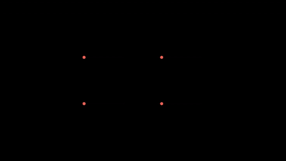
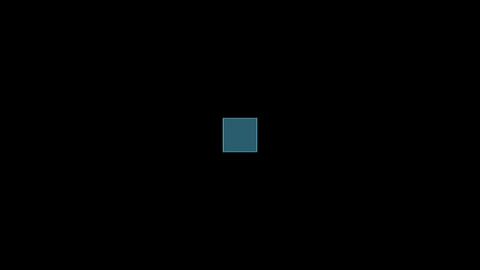
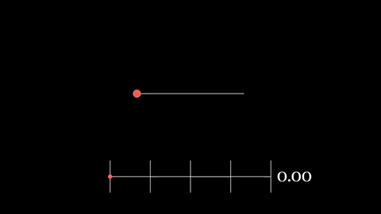

# manim-sceneview

<p align="center">
  
  
</p>

Use a rendered video or a live child scene as an ordinary Manim mobject. Move, scale,
rotate and fade it while its contents keep playing with the host scene clock.
Works with Manim Community (Cairo) and manimgl; importing the package loads neither engine.

- [Installation](#installation)
- [Quick start](#quick-start)
- [Tutorial](#tutorial)
- [Gallery](#gallery)
- [Documentation](#documentation)
- [Development](#development)
- [Licence](#licence)

## Installation

Requires Python >= 3.11, git, and your engine's system dependencies. manimgl rendering
requires ffmpeg on PATH. Tested with CPython 3.11 and 3.13 on Windows 11;
other systems are untested. CE support targets 0.22; GL support targets 1.7.2.
The package is not on PyPI yet.

Install the pinned release (choose your engine):

```sh
pip install "manim-sceneview[ce] @ git+https://github.com/SirJamesClarkMaxwell/manim-sceneview@v0.1.0"
pip install "manim-sceneview[gl] @ git+https://github.com/SirJamesClarkMaxwell/manim-sceneview@v0.1.0"
```

In a uv project:

```sh
uv add "manim-sceneview[ce] @ git+https://github.com/SirJamesClarkMaxwell/manim-sceneview@v0.1.0"
uv add "manim-sceneview[gl] @ git+https://github.com/SirJamesClarkMaxwell/manim-sceneview@v0.1.0"
```

For the current development version, use `@main` instead of `@v0.1.0` in any command
above. For example:

```sh
pip install "manim-sceneview[ce] @ git+https://github.com/SirJamesClarkMaxwell/manim-sceneview@main"
uv add "manim-sceneview[gl] @ git+https://github.com/SirJamesClarkMaxwell/manim-sceneview@main"
```

Use `[ce,gl]` if you need both engines.

**Using slides?** [manim-cue](https://github.com/SirJamesClarkMaxwell/manim-cue) installs
both engines and supports these views inside its `Slide` classes; see
[Embed scenes in slides](https://github.com/SirJamesClarkMaxwell/manim-cue#embed-scenes-in-slides).

## Quick start

From the repository root, first render the shared four-second clip:

```sh
python -m manim render -ql examples/clips.py Source
```

Save this as `first_view.py`, then run `python -m manim render -ql first_view.py Video`.
All video examples below use that same source path, relative to the repository root.
In your own project replace it with any finished constant-frame-rate video.

```python
from manim import PI, RIGHT, FadeIn, Scene

from manimsceneview import SceneView


class Video(Scene):
    def construct(self):
        view = SceneView(self, "media/videos/clips/480p15/Source.mp4", height=4, loop=True)
        self.play(FadeIn(view))
        self.play(view.animate.scale(0.7).shift(2 * RIGHT).rotate(PI / 8), run_time=3)
        self.wait(1)
```

## Tutorial

### 1. SceneView and FrameSource

`SceneView` chooses the engine from its host. `FrameSource` decodes RGBA frames without
Manim; close it when finished. This complete scene samples the clip and displays it.

```python
from manim import Scene
from manimsceneview import FrameSource, SceneView


class Sample(Scene):
    def construct(self):
        source = FrameSource("media/videos/clips/480p15/Source.mp4")
        assert source.rgba(1).shape[2] == 4
        source.close()
        self.add(SceneView(self, "media/videos/clips/480p15/Source.mp4", height=4))
        self.wait(2)
```

### 2. Playback control

`rate` and `loop` are constructor options. `pause`, `resume` and `seek` act immediately,
return the view, and are not animations. `seek(t)` uses clip seconds, independent of rate.

```python
from manim import UP, Scene, Text

from manimsceneview import SceneView


class Control(Scene):
    def construct(self):
        view = SceneView(self, "media/videos/clips/480p15/Source.mp4", height=4, rate=2, loop=True)
        label = Text("2x speed / loop", font_size=30).shift(3 * UP)
        self.add(view, label)
        self.wait(3)
        view.pause()
        label.become(Text("Paused", font_size=30).move_to(label))
        self.wait(1)
        view.seek(1)
        label.become(Text("Seek to 1s / resume", font_size=30).move_to(label))
        view.resume()
        self.wait(2)
```

### 3. ChildView

A live child reads its host through `self.host`; both scenes must use the same engine.
No child movie is written. Add the original view to its host.

```python
from manim import BLUE, RIGHT, UP, Scene, Square

from manimsceneview import ChildView


class Child(Scene):
    def construct(self):
        square = Square(color=BLUE, fill_opacity=0.7)
        self.add(square)
        self.play(square.animate.shift(RIGHT), run_time=1)
        self.wait_until(lambda: self.host.time >= 2)
        self.play(square.animate.shift(UP), run_time=1)


class Host(Scene):
    def construct(self):
        view = ChildView(self, Child, height=4)
        self.add(view)
        self.play(view.animate.scale(0.8).shift(RIGHT), run_time=2)
        self.wait(2)
```

### 4. Combining with ordinary mobjects and animations

Use `Group` for image views (CE `VGroup` accepts vector mobjects only). Each view below
has its own playback; copies of one view share its playback and decoder.

```python
from manim import RIGHT, UP, Group, Scene

from manimsceneview import SceneView


class Grid(Scene):
    def construct(self):
        views = Group(
            *[
                SceneView(
                    self, "media/videos/clips/480p15/Source.mp4", height=2, rate=rate, loop=True
                )
                for rate in (0.5, 1, 1.5, 2)
            ]
        ).arrange_in_grid(rows=2, buff=0.3)
        self.add(views)
        self.wait(2)
        self.play(views.animate.scale(0.8).shift(RIGHT + UP), run_time=2)
        self.wait(1)
```

### 5. manimgl differences

Import scene objects from `manimlib`. Save this as `live_gl.py` and run
`python -m manimlib live_gl.py Host -w -l`. GL draws the child into its own framebuffer
in the host GPU context and samples that texture directly.

```python
from manimlib import BLUE, RIGHT, UP, Scene, Square

from manimsceneview import ChildView


class Child(Scene):
    def construct(self):
        square = Square(color=BLUE, fill_opacity=0.7)
        self.add(square)
        self.play(square.animate.shift(RIGHT), run_time=1)
        self.wait_until(lambda: self.host.time >= 2)
        self.play(square.animate.shift(UP), run_time=1)


class Host(Scene):
    def construct(self):
        view = ChildView(self, Child, height=4)
        self.add(view)
        self.play(view.animate.scale(0.8).shift(RIGHT), run_time=2)
        self.wait(2)
```

### Timing, resources and limitations

The child advances once per host frame by `1 / host_fps`, including during `host.wait()`
and animations of the view. The first sample is at `1 / host_fps`; there is no extra output
sample at zero. Each child `play` or `wait` rounds its duration up to a whole host frame,
includes its final sample, and leaves the final image visible after completion. Repeated
updates at the same host time do not advance the child. Python and NumPy RNG states are
kept separately for host and child; set the child's normal random seed for reproducibility.

The view owns its greenlet and resources. Removing it with `host.remove(view)` (also inside
a group), calling `view.close()`, or ending the host render closes it explicitly. Host
`remove` and `tear_down` overrides are preserved. Copies used by animations share the child;
add the original view to its host. Closing is permanent; create a new view to run it again.

ChildView limitations:

- Cooperative execution on one thread: child code between `play()` / `wait()` calls blocks
  the host. A child must yield regularly.
- Fixed child camera only: no `MovingCameraScene`, `ThreeDScene`, or GL camera frame motion.
  Configure the child's camera before its animation instead. The camera's background color
  is retained, with background opacity forced to zero.
- No child audio or sections, and no nested ChildView.
- CE host render cache is disabled from creation of the first ChildView, with one warning
  per host. CE uses the child's configured Cairo camera at the view's initial pixel size;
  enlarging the view later can soften the image.
- GL support uses the ManimGL 1.7.2 scene initialization and shader API.

SceneView limitations:

- Constant-frame-rate videos only.
- Seeking backwards decodes again from the start of the file.
- `become` or `Transform` between two views keeps geometry and opacity, but not the video
  source.
- Manim Community support is tested on 0.22 only, manimgl on 1.7.

The video clock is absolute host time since the first frame read, so playback does not
drift across `play()` calls. `current_frame()` returns the current RGBA NumPy array.

## Gallery

Click a GIF for its runnable source; each file documents its render commands and paths.
The source clip is [`clips.py`](examples/clips.py). All movies and GIFs sit beside the code.

<table>
<tr>
<td width="50%"><a href="examples/01_video.py"></a><br><b>Video as a mobject</b> - Fade, move, scale and rotate a playing clip. <a href="examples/01_video.mp4">video</a></td>
<td width="50%"><a href="examples/02_playback.py"></a><br><b>Playback control</b> - Pause, seek, resume and loop at double speed. <a href="examples/02_playback.mp4">video</a></td>
</tr>
<tr>
<td width="50%"><a href="examples/03_grid.py"></a><br><b>Several views</b> - Independent playback rates in one animated group. <a href="examples/03_grid.mp4">video</a></td>
<td width="50%"><a href="examples/04_child.py"></a><br><b>Live child</b> - A child waits for its host clock. <a href="examples/04_child.mp4">video</a> | <a href="examples/gl/04_child.py">GL variant</a></td>
</tr>
<tr>
<td width="50%"><a href="examples/05_sliders.py"></a><br><b>One slider, two children</b> - A host tracker controls a wave and spinner. <a href="examples/05_sliders.mp4">video</a> | <a href="examples/gl/05_sliders.py">GL variant</a></td>
<td width="50%"><a href="examples/06_scrub.py"></a><br><b>Scrubbing</b> - A slider seeks forwards and backwards in a finished clip. <a href="examples/06_scrub.mp4">video</a> | <a href="examples/gl/06_scrub.py">GL variant</a></td>
</tr>
</table>

`ChildView` only steps forwards. Scrubbing pauses a `SceneView` and maps [0, 1] to
[0, 4] clip seconds; backward seeking decodes from the start without a new cache.

## Documentation

- [API reference](docs/api.md): signatures, parameters, methods and errors.
- [Changelog](CHANGELOG.md).

## Development

```sh
uv sync --all-extras
uv run pytest                         # includes GPU tests; requires an OpenGL context
uv run pytest -m "not gpu"             # CPU tests only
uv run python tools/examples.py        # regenerate all CE movies and GIFs
uv run python tools/examples.py --gl   # also render the GL variants, without GIFs
uv run python tools/examples.py scrub  # optional filename filter
uv run ruff check .
uv run ruff format --check .
```

The example tool needs ffmpeg on PATH and writes scratch renders to `.example-media/`.
See [CONTRIBUTING.md](CONTRIBUTING.md) for conventions.

## Licence

manim-sceneview is created and maintained by
[SirJamesClarkMaxwell](https://github.com/SirJamesClarkMaxwell), who conceived the project.
It is released under the [MIT License](https://github.com/SirJamesClarkMaxwell/manim-sceneview/blob/main/LICENSE).

- It was first developed inside [manim-cue](https://github.com/SirJamesClarkMaxwell/manim-cue),
  the author's presentation tool, which is built on
  [manim-slides](https://github.com/jeertmans/manim-slides) by Jérome Eertmans.
- **[Manim Community](https://github.com/ManimCommunity/manim)** and
  **[manimgl](https://github.com/3b1b/manim)** by Grant Sanderson (3Blue1Brown) are the
  animation engines it builds on.
- **[PyAV](https://github.com/PyAV-Org/PyAV)** decodes the video frames.
